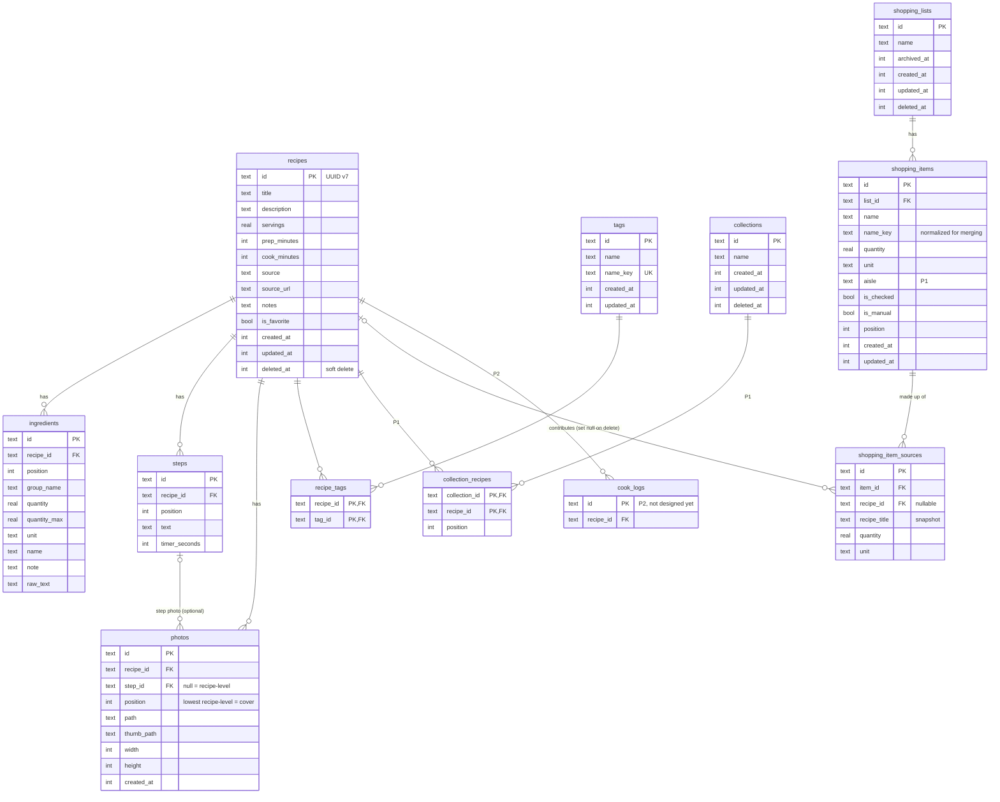

# Data Model — ORM Schema and Business Models (Draft for Review)

Covers the P0 scope plus the P1 tables we should shape now so we don't migrate painfully later. Items marked **(P1)** can be created later; the design just leaves room for them.

## 1. ER Overview



## 2. ORM Schema (Drizzle, SQLite)

```ts
// src/data/db/schema/common.ts
import { integer, text } from 'drizzle-orm/sqlite-core';

export const id = () => text('id').primaryKey();                       // UUID v7
export const timestamps = {
  createdAt: integer('created_at').notNull(),                          // epoch ms
  updatedAt: integer('updated_at').notNull(),
};
export const softDelete = {
  deletedAt: integer('deleted_at'),                                    // null = active
};
```

```ts
// src/data/db/schema/recipes.ts
export const recipes = sqliteTable('recipes', {
  id: id(),
  title: text('title').notNull(),
  description: text('description'),
  servings: real('servings').notNull().default(4),
  prepMinutes: integer('prep_minutes'),
  cookMinutes: integer('cook_minutes'),
  source: text('source'),                 // "Grandma", "NYT Cooking"
  sourceUrl: text('source_url'),
  notes: text('notes'),
  isFavorite: integer('is_favorite', { mode: 'boolean' }).notNull().default(false),
  ...timestamps,
  ...softDelete,
}, (t) => [
  index('recipes_deleted_idx').on(t.deletedAt),
  index('recipes_title_idx').on(t.title),
]);

export const ingredients = sqliteTable('ingredients', {
  id: id(),
  recipeId: text('recipe_id').notNull().references(() => recipes.id, { onDelete: 'cascade' }),
  position: integer('position').notNull(),
  groupName: text('group_name'),          // "For the sauce"; null = ungrouped
  quantity: real('quantity'),             // null = "to taste", "a pinch"
  quantityMax: real('quantity_max'),      // upper bound for ranges ("2–3")
  unit: text('unit'),                     // canonical unit key, e.g. 'tbsp'; null = count/none
  name: text('name').notNull(),           // "flour"
  note: text('note'),                     // "sifted"
  rawText: text('raw_text'),              // original user input, display fallback
}, (t) => [index('ingredients_recipe_idx').on(t.recipeId, t.position)]);

export const steps = sqliteTable('steps', {
  id: id(),
  recipeId: text('recipe_id').notNull().references(() => recipes.id, { onDelete: 'cascade' }),
  position: integer('position').notNull(),
  text: text('text').notNull(),
  timerSeconds: integer('timer_seconds'),  // (P1/P2) suggested timer
}, (t) => [index('steps_recipe_idx').on(t.recipeId, t.position)]);

export const photos = sqliteTable('photos', {
  id: id(),
  recipeId: text('recipe_id').notNull().references(() => recipes.id, { onDelete: 'cascade' }),
  stepId: text('step_id').references(() => steps.id, { onDelete: 'set null' }), // null = recipe-level
  position: integer('position').notNull(), // recipe-level photo with lowest position = cover
  path: text('path').notNull(),            // relative: photos/<id>.jpg
  thumbPath: text('thumb_path').notNull(),
  width: integer('width').notNull(),
  height: integer('height').notNull(),
  createdAt: integer('created_at').notNull(),
}, (t) => [index('photos_recipe_idx').on(t.recipeId, t.position)]);
```

```ts
// src/data/db/schema/tags.ts
export const tags = sqliteTable('tags', {
  id: id(),
  name: text('name').notNull(),            // stored as typed
  nameKey: text('name_key').notNull().unique(), // lowercased/trimmed, for uniqueness
  ...timestamps,
});

export const recipeTags = sqliteTable('recipe_tags', {
  recipeId: text('recipe_id').notNull().references(() => recipes.id, { onDelete: 'cascade' }),
  tagId: text('tag_id').notNull().references(() => tags.id, { onDelete: 'cascade' }),
}, (t) => [primaryKey({ columns: [t.recipeId, t.tagId] })]);

// (P1)
export const collections = sqliteTable('collections', {
  id: id(), name: text('name').notNull(), ...timestamps, ...softDelete,
});
export const collectionRecipes = sqliteTable('collection_recipes', {
  collectionId: text('collection_id').notNull().references(() => collections.id, { onDelete: 'cascade' }),
  recipeId: text('recipe_id').notNull().references(() => recipes.id, { onDelete: 'cascade' }),
  position: integer('position').notNull().default(0),
}, (t) => [primaryKey({ columns: [t.collectionId, t.recipeId] })]);
```

```ts
// src/data/db/schema/shopping.ts
export const shoppingLists = sqliteTable('shopping_lists', {
  id: id(),
  name: text('name').notNull(),
  archivedAt: integer('archived_at'),
  ...timestamps,
  ...softDelete,
});

export const shoppingItems = sqliteTable('shopping_items', {
  id: id(),
  listId: text('list_id').notNull().references(() => shoppingLists.id, { onDelete: 'cascade' }),
  name: text('name').notNull(),
  nameKey: text('name_key').notNull(),     // normalized, used for merging
  quantity: real('quantity'),
  unit: text('unit'),
  aisle: text('aisle'),                    // (P1) 'produce' | 'dairy' | ...
  isChecked: integer('is_checked', { mode: 'boolean' }).notNull().default(false),
  isManual: integer('is_manual', { mode: 'boolean' }).notNull().default(false),
  position: integer('position').notNull().default(0),
  ...timestamps,
}, (t) => [index('shopping_items_list_idx').on(t.listId)]);

// Which recipes contributed to an item, and how much (supports "from: Lasagna, Salad")
export const shoppingItemSources = sqliteTable('shopping_item_sources', {
  id: id(),
  itemId: text('item_id').notNull().references(() => shoppingItems.id, { onDelete: 'cascade' }),
  recipeId: text('recipe_id').references(() => recipes.id, { onDelete: 'set null' }),
  recipeTitle: text('recipe_title').notNull(), // snapshot, survives recipe deletion
  quantity: real('quantity'),
  unit: text('unit'),
});
```

```sql
-- hand-written migration: full-text search (FTS5)
CREATE VIRTUAL TABLE recipes_fts USING fts5(
  recipe_id UNINDEXED, title, description, ingredients, tags,
  tokenize = 'unicode61 remove_diacritics 2', prefix = '2 3'
);
-- Rows are written/refreshed by recipeRepo.save() and removed on hard/soft delete.
```

### Schema decisions to confirm

| # | Decision | Rationale | Alternative |
|---|---|---|---|
| 1 | Cover photo = lowest-position recipe-level photo | Avoids a circular FK between `recipes` and `photos` | `recipes.coverPhotoId` column |
| 2 | Soft delete on recipes, lists, collections only | Supports "recently deleted" and future sync. Children cascade on hard delete | Soft delete everywhere |
| 3 | Tags only; no separate "category" | One mechanism covers dinner/dessert/vegetarian. UI can group tags later | Separate `category` enum |
| 4 | Shopping items keep a snapshot of the recipe title | List still makes sense after a recipe is deleted | Join live to recipes |
| 5 | FTS maintained in the repository, not triggers | Content spans several tables; triggers get complicated | SQL triggers |
| 6 | `servings` is `real` | Allows 1.5 servings and scaled values | integer |
| 7 | Ingredient grouping via `groupName` string | Simple, enough for "For the sauce" headers | A separate `ingredient_groups` table |

## 3. Business (Domain) Models

Pure TypeScript in `src/domain/`. These are the shapes the UI and repositories use; they differ from rows (for example, `Recipe` aggregates its children).

```ts
// ── Primitives ─────────────────────────────────────────────
export type Id = string;
export type EpochMs = number;

export type UnitDimension = 'volume' | 'mass' | 'count';

export interface UnitDef {
  key: string;                 // 'tbsp'
  dimension: UnitDimension;
  system: 'metric' | 'imperial' | 'universal';
  toBase: number;              // factor to base unit (ml for volume, g for mass)
  labels: string[];            // parsing aliases: ['tbsp', 'tablespoon', 'tablespoons', 'T']
}

/** A quantity of something. `value` null means unspecified ("to taste"). */
export interface Quantity {
  value: number | null;
  max?: number;                // range upper bound
  unit: string | null;         // UnitDef.key or null
}

// ── Recipe aggregate ───────────────────────────────────────
export interface Ingredient {
  id: Id;
  groupName: string | null;
  quantity: Quantity;
  name: string;
  note: string | null;
  rawText: string | null;
}

export interface Step {
  id: Id;
  text: string;
  timerSeconds: number | null;
}

export interface Photo {
  id: Id;
  stepId: Id | null;
  uri: string;                 // resolved absolute file URI
  thumbUri: string;
  width: number;
  height: number;
}

export interface Recipe {
  id: Id;
  title: string;
  description: string | null;
  servings: number;
  prepMinutes: number | null;
  cookMinutes: number | null;
  totalMinutes: number | null;   // derived
  source: string | null;
  sourceUrl: string | null;
  notes: string | null;
  isFavorite: boolean;
  tags: string[];
  ingredients: Ingredient[];     // ordered
  steps: Step[];                 // ordered
  photos: Photo[];               // ordered; cover = first with stepId null
  createdAt: EpochMs;
  updatedAt: EpochMs;
}

/** Lightweight version for list screens: no ingredients or steps loaded. */
export interface RecipeSummary {
  id: Id;
  title: string;
  coverThumbUri: string | null;
  totalMinutes: number | null;
  isFavorite: boolean;
  tags: string[];
}

/** Editor input: same as Recipe, but ids optional for new rows, no derived fields. */
export type RecipeDraft = Omit<Recipe, 'id' | 'createdAt' | 'updatedAt' | 'totalMinutes' | 'photos'> & {
  id?: Id;
  photos: PhotoDraft[];
};

// ── Shopping ───────────────────────────────────────────────
export interface ShoppingItem {
  id: Id;
  name: string;
  quantity: Quantity;
  aisle: string | null;
  isChecked: boolean;
  isManual: boolean;
  sources: { recipeId: Id | null; recipeTitle: string; quantity: Quantity }[];
}

export interface ShoppingList {
  id: Id;
  name: string;
  items: ShoppingItem[];
  createdAt: EpochMs;
  updatedAt: EpochMs;
}

/** Input to list generation. */
export interface ShoppingSelection {
  recipe: Recipe;
  targetServings: number;
}
```

## 4. Domain Services (pure functions)

| Module | Function | Behavior |
|---|---|---|
| `units` | `getUnit(keyOrAlias)`, `convert(q, toUnit)` | Convert within a dimension only. Returns `null` if incompatible |
| `units` | `toDisplayUnit(q, system)` | Pick a human-friendly unit (1000 ml → 1 L; 3 tsp → 1 tbsp) |
| `quantity` | `parseQuantity("1 1/2")`, `formatQuantity(1.5)` | Handles integers, decimals, fractions, unicode fractions (½), ranges |
| `parse` | `parseIngredientLine("2 cups flour, sifted")` | Returns `{ quantity, name, note }`. Falls back to `name = whole line` |
| `scale` | `scaleIngredients(ingredients, fromServings, toServings)` | Multiplies quantities; leaves null quantities alone |
| `normalize` | `normalizeName("Yellow Onions")` → `"yellow onion"` | Lowercase, trim, simple singularization, strip descriptors such as "fresh" |
| `merge` | `mergeIngredients(scaled[])` → `MergedItem[]` | Groups by `nameKey`; sums when units are convertible; otherwise keeps separate lines |
| `shopping` | `buildShoppingList(selections, name)` | Orchestrates scale → merge → ShoppingItem[] with sources |
| `recipe` | `totalMinutes(recipe)`, `validateDraft(draft)` | Derived values and validation rules |

### Merge rules (to confirm)
1. Same `nameKey` and same unit → add quantities.
2. Same `nameKey`, different units in the same dimension → convert to the first unit, add.
3. Same `nameKey`, different dimensions (e.g. "1 onion" vs "100 g onion") → keep as separate lines. No density conversions.
4. Null quantities ("salt, to taste") → merge into a single line with no quantity.
5. Result quantities are tidied for display (e.g. 0.333 cups → ⅓ cup) but stored unrounded.

## 5. Repositories (data-layer API)

```ts
interface RecipeRepository {
  list(opts: { search?: string; tags?: string[]; favoritesOnly?: boolean;
               sort?: 'title' | 'createdAt' | 'updatedAt' }): Promise<RecipeSummary[]>;
  get(id: Id): Promise<Recipe | null>;
  save(draft: RecipeDraft): Promise<Recipe>;      // upsert aggregate + refresh FTS, one transaction
  duplicate(id: Id): Promise<Recipe>;             // (P1)
  setFavorite(id: Id, value: boolean): Promise<void>;
  softDelete(id: Id): Promise<void>;
  restore(id: Id): Promise<void>;                 // (P1)
  purgeDeleted(olderThanMs: number): Promise<void>;
}

interface PhotoStore {
  importFromUri(uri: string): Promise<{ path: string; thumbPath: string; width: number; height: number }>;
  delete(paths: string[]): Promise<void>;
  resolve(relativePath: string): string;
}

interface ShoppingRepository {
  listLists(): Promise<ShoppingListSummary[]>;
  get(id: Id): Promise<ShoppingList | null>;
  createFromSelections(name: string, selections: ShoppingSelection[]): Promise<ShoppingList>;
  addToList(listId: Id, selections: ShoppingSelection[]): Promise<ShoppingList>;
  addManualItem(listId: Id, item: { name: string; quantity?: Quantity }): Promise<void>;
  updateItem(itemId: Id, patch: Partial<Pick<ShoppingItem, 'name' | 'quantity' | 'isChecked' | 'aisle'>>): Promise<void>;
  deleteItem(itemId: Id): Promise<void>;
  clearChecked(listId: Id): Promise<void>;
  softDelete(id: Id): Promise<void>;
}

interface TagRepository {
  listAll(): Promise<{ name: string; count: number }[]>;
}
```

## 6. Open Questions for Review

1. ~~Aggregate save strategy~~ **Resolved:** all ids are generated client-side (including new recipes/steps), so `save` upserts steps and photos by id and replaces ingredients wholesale.
2. **Adding to an existing list**: when a recipe's ingredients are added to a list with checked items, should a checked "2 onions" absorb new onions (unchecking it), or should a new line be created? Recommendation: create a new unchecked line for the extra quantity.
3. **Ingredient name matching**: simple normalization (plural, case) is the plan. Do we want a synonyms list (scallion = green onion) now or later? Recommendation: later.
4. **Aisle categories**: assign automatically from a built-in dictionary (P1), or leave manual? Recommendation: small built-in dictionary, user-overridable.
5. **Unit system on display**: store what the user typed, and convert only for display when a preference is set? Recommendation: yes, never rewrite stored data.
6. **Recipe photos limit**: cap per recipe (e.g. 10) to bound storage? Recommendation: soft cap of 10 with a warning.
7. **Servings for list generation**: remember the last-used servings per recipe, or always default to the recipe's own? Recommendation: always default to the recipe's own.
