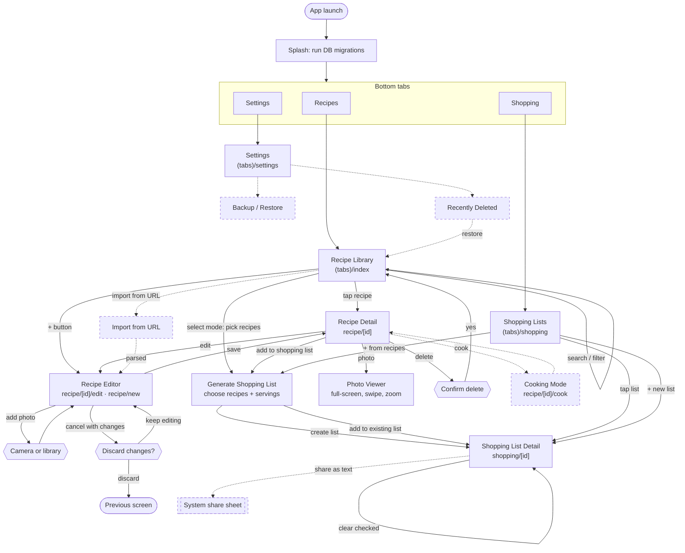
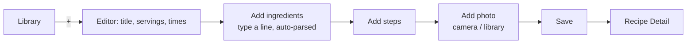
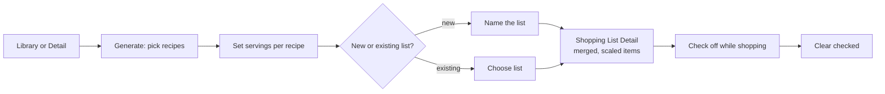

# Screen Flow

Navigation map for the app. Routes follow Expo Router file paths under `src/app/`. P1 screens are dashed.

## 1. Overview

## 2. Core MVP Journeys

### Add a recipe with a photo

### Build a shopping list from recipes

## 3. Screen Inventory

| Screen | Route | Purpose | Priority |
|---|---|---|---|
| Recipe Library | `(tabs)/index` | Browse, search, filter recipes; entry to create | P0 |
| Recipe Detail | `recipe/[id]` | View ingredients, steps, photos; scale servings; actions | P0 |
| Recipe Editor | `recipe/[id]/edit`, `recipe/new` | Create and edit all recipe fields and photos | P0 |
| Photo Viewer | modal | Full-screen photos with zoom and swipe | P0 |
| Shopping Lists | `(tabs)/shopping` | All lists with progress counts | P0 |
| Generate Shopping List | modal | Pick recipes and servings, create or add to a list | P0 |
| Shopping List Detail | `shopping/[id]` | Check off, edit, add and clear items | P0 |
| Settings | `(tabs)/settings` | Units, theme; links to backup and trash | P1 |
| Cooking Mode | `recipe/[id]/cook` | Step-by-step, screen stays awake | P1 |
| Recently Deleted | `settings/trash` | Restore or purge deleted recipes | P1 |
| Backup / Restore | `settings/backup` | Export and import library | P1 |
| Import from URL | modal | Paste a link to prefill the editor | P1 |

## 4. Navigation Notes

- **Tabs** are the only top-level navigation: Recipes, Shopping, Settings.
- **Detail and editor** are pushed onto the stack above the tabs; Editor "save" replaces itself with Detail so back goes to the Library, not back into the editor.
- **Photo Viewer, Generate, and Import** are modals, dismissed by swipe or close button.
- **Unsaved changes:** the Editor intercepts back and swipe gestures and asks before discarding. A draft is also auto-saved so an app kill does not lose work.
- **Deep entry points:** "Add to shopping list" is available from both Library (multi-select) and Detail (single recipe), and lands in the same Generate screen.
